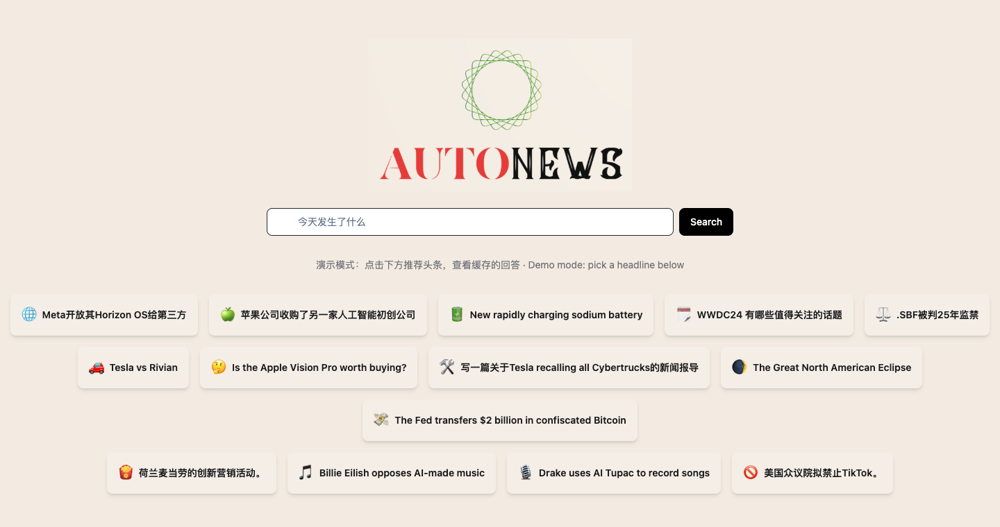

# Autonews

[](https://autonews-theta.vercel.app/)

Autonews is an AI news search assistant. Ask about a headline and it searches the web, reads the top results, and writes a cited, news-style answer with GPT, in the language you asked in.

Autonews is a fork / variant of [mckaywrigley/clarity-ai](https://github.com/mckaywrigley/clarity-ai) (Clarity AI, a Perplexity-style GPT wrapper), customized by [Yevanchen](https://github.com/Yevanchen).

Live demo: [autonews-theta.vercel.app](https://autonews-theta.vercel.app/)

## Demo mode

Autonews 已停止运营. The hosted site stays online as a demo only, and it makes no OpenAI calls and does no web scraping:

- The recommended headlines on the homepage return pre-cached answers with their source links, stored in [`data/demo-cache.json`](./data/demo-cache.json).
- Any other query shows a "停止运营 / demo only" notice instead of running a search.
- `/api/sources` and `/api/answer` reject requests, so the live pipeline can't run up API costs even when called directly.

Demo mode is on unless `DEMO_MODE=false` is set. The cached answers are static snapshots; edit `data/demo-cache.json` to change them.

## How It Works

With demo mode off, Autonews works as follows:

1. Get query from user
2. Scrape Google for relevant webpages
3. Fetch each page through the `r.jina.ai` reader and extract its text
4. Build a prompt from the page text
5. Call the OpenAI API (`gpt-4-turbo`) with a news-editor system prompt
6. Stream the Markdown answer back with numbered source citations

Google now often blocks this kind of scraping, so step 2 can come back empty. A search API is the more reliable option.

## What's Different From Clarity

- A news-editor system prompt: Markdown headings and lists, pyramid-style summaries, and answers in the user's language
- Recommended headline shortcuts on the homepage, in Chinese and English
- The OpenAI key is read on the server from `OPENAI_API_KEY`
- Markdown-rendered answers and a newspaper-style look
- Demo mode with cached answers

## Requirements

Get an OpenAI API key [here](https://platform.openai.com/api-keys).

## Running Locally

1. Clone repo

```bash
git clone https://github.com/Yevanchen/AutoNews.git
cd AutoNews
```

2. Install dependencies

```bash
npm i
```

3. Add your key

Create a `.env.local` file:

```bash
OPENAI_API_KEY=sk-...
# Leave the next line out to run the cached demo instead
DEMO_MODE=false
```

4. Run app

```bash
npm run dev
```

Then open http://localhost:3000.

## Deploying

On Vercel, set `DEMO_MODE=true` (or leave it unset) to keep the deployment in demo mode. Live mode needs both `DEMO_MODE=false` and `OPENAI_API_KEY`.

## Credits

Autonews builds on [Clarity AI](https://github.com/mckaywrigley/clarity-ai) by [Mckay Wrigley](https://twitter.com/mckaywrigley) (MIT License), which was inspired by [Perplexity AI](https://www.perplexity.ai/).
